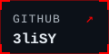

<picture><source media="(max-width: 600px)" srcset="assets/m/hero.svg"></picture> 
<picture><source media="(max-width: 600px)" srcset="assets/m/profile.svg"></picture> 
<a href="https://github.com/3liSY/Steve_Subscribe_Animation"><picture><source media="(max-width: 600px)" srcset="assets/m/project-steve.svg"></picture></a> 
<picture><source media="(max-width: 600px)" srcset="assets/m/project-bot.svg"></picture> 
<a href="https://www.youtube.com/@SRBGamerr"><picture><source media="(max-width: 600px)" srcset="assets/m/creator.svg"></picture></a> 
<picture><source media="(max-width: 600px)" srcset="assets/m/world.svg"></picture> 
<picture><source media="(max-width: 600px)" srcset="assets/m/contact.svg"></picture> 
<a href="https://github.com/3liSY"><picture><source media="(max-width: 600px)" srcset="assets/m/btn-github.svg"></picture></a><a href="https://www.youtube.com/@SRBGamerr"><picture><source media="(max-width: 600px)" srcset="assets/m/btn-youtube.svg"></picture></a><a href="https://discord.gg/stormygang"><picture><source media="(max-width: 600px)" srcset="assets/m/btn-discord.svg"></picture></a><a href="https://instagram.com/srbgamerr"><picture><source media="(max-width: 600px)" srcset="assets/m/btn-instagram.svg"></picture></a><a href="https://rootapp.gg/ADKfuKm8iAqsHygl-sn8Pg"><picture><source media="(max-width: 600px)" srcset="assets/m/btn-rootapp.svg"></picture></a> 
<picture><source media="(max-width: 600px)" srcset="assets/m/footer.svg"></picture>

